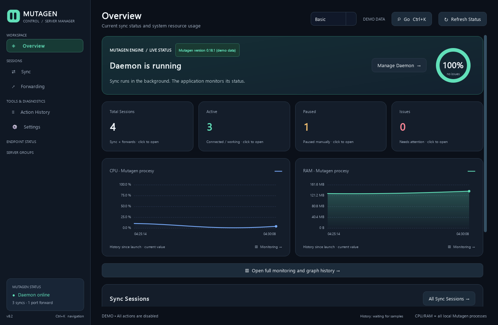
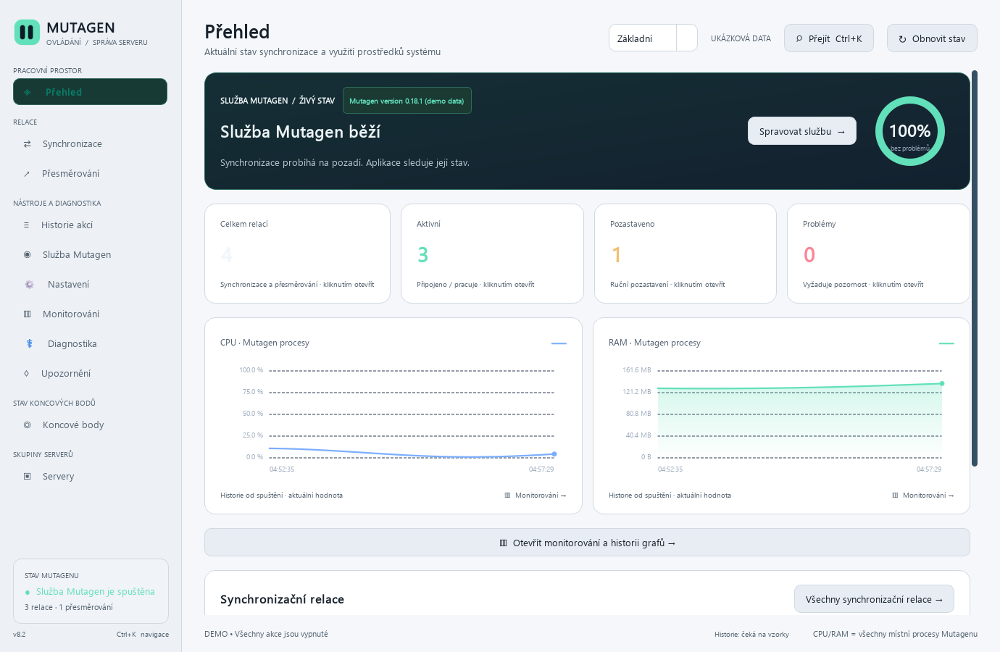
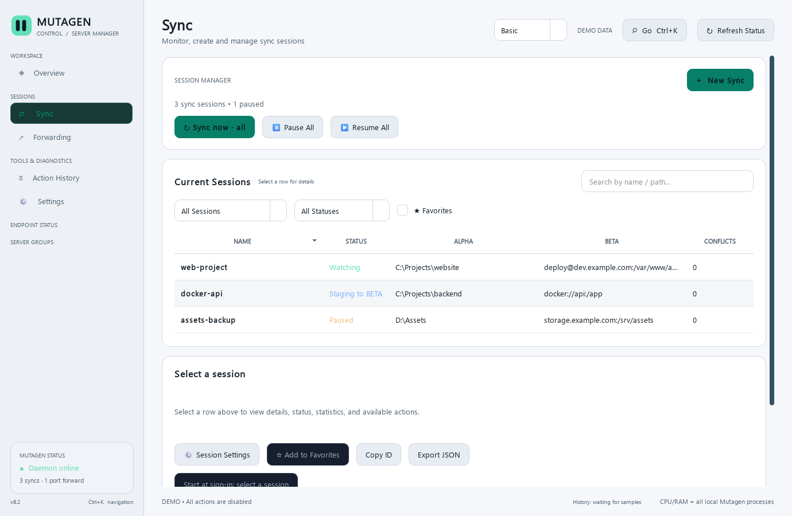
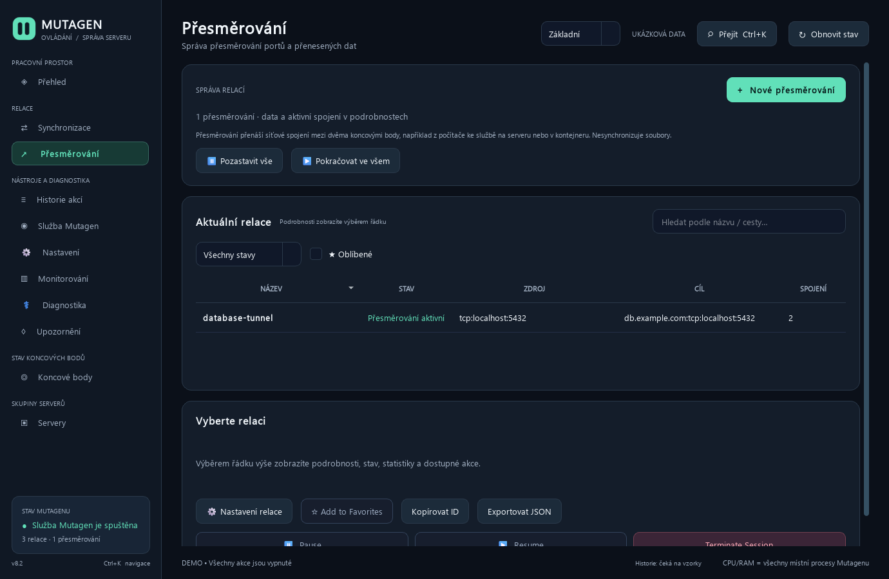
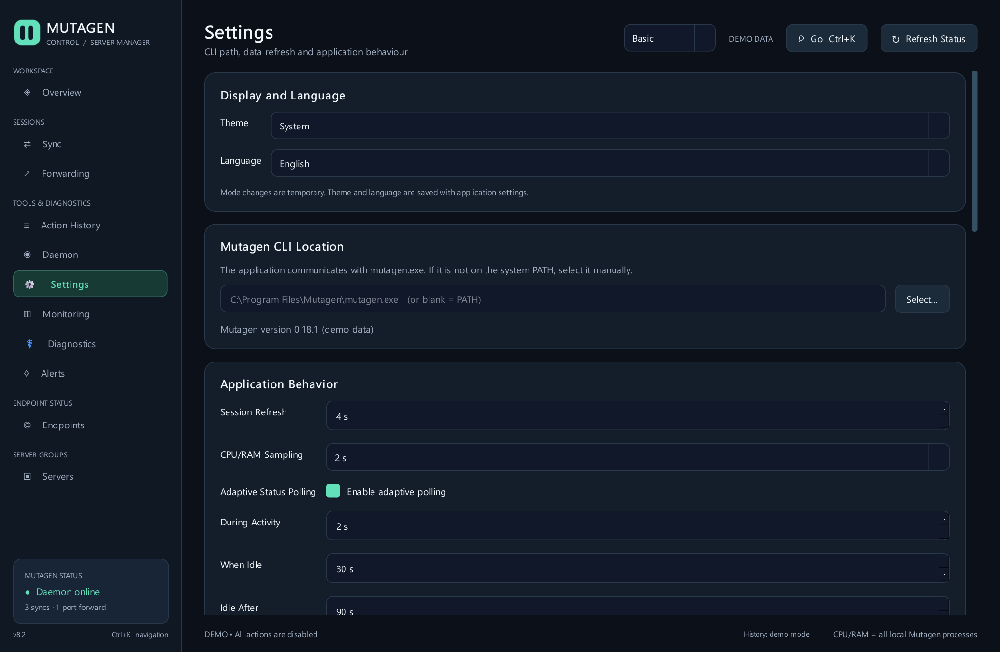
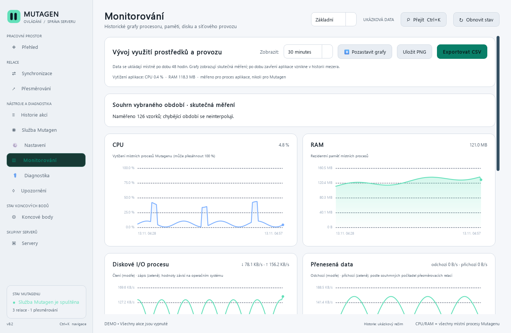

# Mutagen Control

Standalone GUI for the existing Mutagen CLI. It does not install a service on the server, open its own SSH session, or install a remote agent. It reads output from `mutagen sync list` and `mutagen forward list` through the local daemon.

Use one desktop interface to review sessions, configure new syncs and forwards, inspect diagnostics, and monitor activity. Mutagen CLI and its daemon remain the source of truth.

## Platforms and first use

Release automation builds Windows x64, macOS Apple Silicon and Intel, and Ubuntu x86-64 packages. Package creation and CI self-tests are not a support guarantee for every OS version: native macOS GUI acceptance and Linux distributions outside the Ubuntu CI image remain unverified. See the [capability matrix](docs/capability-matrix.md) and [acceptance evidence](docs/acceptance-traceability.md).

Install Mutagen CLI separately using the [official installation guide](https://mutagen.io/documentation/introduction/installation). Start MutaUI, confirm onboarding detects the CLI, then create a sync between two disposable local folders. Review the mode and operation preview before starting. Check the result, then stop and remove the test session. Follow the [Windows](docs/getting-started/windows.md), [macOS](docs/getting-started/macos.md), or [Linux](docs/getting-started/linux.md) setup and the [first-sync guide](docs/getting-started/first-sync.md) before connecting important data or SSH endpoints.

## FAQ

- **Does MutaUI include Mutagen?** No. Install the Mutagen CLI separately; MutaUI uses the local CLI and daemon.
- **Does it connect to endpoints on startup?** No. Onboarding checks the installed CLI and its help output; it does not auto-connect.
- **Does it download or install updates?** No. Release checks are off by default. Enable and save **Settings → Alerts → Check releases on startup** to allow startup checks; the same page offers a manual check while enabled. MutaUI sends no device or session data and never downloads or installs an update.
- **Will changing a profile rewrite a running session?** No. Profiles set defaults for new sessions. Existing Mutagen configuration is left intact.
- **Where are downloads and setup help?** Use the project’s GitHub Releases page and the [installation guide](docs/installation.md). For recovery, see [Troubleshooting](docs/troubleshooting.md).
- **Which license applies?** This checkout has no `LICENSE` or `COPYING` file. Reuse and redistribution terms are therefore unspecified; obtain the project owner’s direction before treating the code as open source.

For bug reports, use the repository’s Issues tab and include OS version, MutaUI release, Mutagen version, and reproduction steps. Remove credentials, private paths, and host details from logs before sharing them.

See [Support](SUPPORT.md), [Security policy](SECURITY.md), and [Contributing](CONTRIBUTING.md) for safe reporting, vulnerability disclosure, and development checks.

## Screenshots

Actual UI captures from the offline demo. Demo data is synthetic and operations are disabled. See the [full screenshot gallery](docs/screenshots.md).

| Overview — English, dark | Overview — Czech, light | Sync — English, light |
| --- | --- | --- |
|  |  |  |

| Forward — Czech, dark | Settings — English, dark | Monitoring — Czech, light |
| --- | --- | --- |
|  |  |  |

## Run and verify

See [installation and upgrade](docs/installation.md) for the Windows installer and current macOS/Linux packaging status.

1. Extract the ZIP into a **new folder** (do not merge it with v8/v8.1).
2. Run `start.cmd` (creates a local Python environment and installs dependencies).
3. Try `demo.cmd` first, then optionally run `check_windows.cmd`.
4. `build_fast.cmd` creates `dist-fast\MutagenControl\MutagenControl.exe` in a portable folder; **copy the entire folder**.
5. `build_exe.cmd` creates the single-file `dist\MutagenControl.exe`. Python is required during the build, but not to run the EXE. Mutagen CLI must be available on the computer.

All build scripts run the Qt GUI smoke test. If it fails, **the build stops without creating a new EXE**. Use a freshly built version, not old files in `dist-debug`.

## Settings

On first launch, the onboarding guide checks the local Mutagen CLI version and sync/forward help. It does not auto-connect to endpoints. The optional local sync test uses disposable folders and an isolated Mutagen data directory; the installation link opens Mutagen's official guide only when selected.

**Settings → Application Behavior**: status polling interval, adaptive interval during activity, interval after an idle period, idle duration, CPU/RAM sampling interval, and power-saving mode in the system tray. These settings control only how often the GUI polls; **they do not change Mutagen's sync algorithm**.

The **Basic / Advanced** selector changes which navigation pages are shown for the current run; it does not save settings or modify Mutagen data. **Settings → Display and Language** provides System/Light/Dark themes and an EN/CS language foundation. Theme and language choices are saved with application settings.

**Default profile for new sync sessions**: choose the default file change detection profile selected in the `New Sync` dialog.

**New Sync / New Forward** follow the current Basic/Advanced mode. Basic sync shows two safe modes; Advanced exposes resolved and replica modes with explicit risk confirmation. Both wizards show the exact executable and argument list as JSON, without shell parsing. Sync ignore presets cover Python, Node.js, PHP/Composer, and common IDE/log files. Forward TCP ports are range-checked, and public bind addresses require confirmation.

**Ignore Presets** are stored separately with ordered rules and backups. The sync wizard can load custom presets, stage `.gitignore`/`.dockerignore` conversion, identify possible `!` overrides, skip unsupported lines, and preview how the current draft treats a relative path. Conversion never edits the source ignore file or deletes files. Path matching is an approximation until checked with the installed Mutagen CLI. Portable bundles validate and preview custom presets before create/replace/skip.

**Settings → Native Mutagen Projects** creates new or inspects existing `mutagen.yml` files. Creation never overwrites. The inspector shows syncs, forwards, defaults, session settings, hooks, custom commands, and debounced external edits. Project actions show exact arguments and hook commands, require explicit consent, and write a local audit. Hook/custom-command actions can run arbitrary shell code; real CLI behavior remains unverified here because Mutagen is not installed.

**Per session → Session Settings**: local note, notifications, native sync/forward values, source/impact/help, endpoint-specific fields, and proposed replacement values. Socket overwrite, owner, group, and permission drafts stay in MutaUI's local preferences. Existing sessions remain unchanged; fields needing installed CLI, endpoint, or platform verification are marked unverified.

**Settings → Connection Profiles** stores versioned local endpoint pairs, validated defaults, tags, and favorites in a separate profile file. Profiles can be searched, duplicated, marked favorite, or deleted, then selected when creating a session. A profile never changes an existing Mutagen session.

**Settings → SSH Profiles** reads `~/.ssh/config` and bounded `Include` files without writing them. Select an alias to inspect the effective local `ssh -G` options. The explicit connection test uses batch mode and `StrictHostKeyChecking=yes`; it never adds host keys, changes `known_hosts`, reads private-key contents, or disables host-key checks.

**Portable Import/Export** uses a checksummed, versioned JSON bundle with preview and per-profile create/merge/skip choices. Absolute local endpoint paths are redacted by default; path inclusion requires a separate confirmation. Executable paths, SSH key material, session notes, Mutagen state, and history are excluded. Legacy settings can be migrated with an exact byte backup and rolled back from that backup. Import and migration affect local MutaUI files only.

### Profiles for new sync sessions

| Profile | Options passed at creation |
| --- | --- |
| Default | Keep Mutagen's default configuration |
| Event-driven | `--watch-mode=portable --scan-mode=accelerated` |
| Fast polling | `--watch-mode=force-poll --watch-polling-interval=5` |
| Medium polling | `--watch-mode=force-poll --watch-polling-interval=20` |
| Power-saving polling | `--watch-mode=force-poll --watch-polling-interval=60` |
| Manual | `--watch-mode=no-watch` |

`no-watch` does not pause a session; use **Sync Now** (`mutagen sync flush`) to force a cycle. The filesystem polling interval is separate from data transfer speed, which the GUI cannot reliably limit.

## Bulk actions and servers

The `Servers` page groups sessions by protocol, host, and port without DNS lookups. A sync session can belong to two remote hosts when both ALPHA and BETA are remote. Exact session IDs are passed to `mutagen sync flush|pause|resume|reset|terminate` or the equivalent forwarding commands. The application does not use `--all` or act on unrelated hosts.

Automatic start for native sessions uses per-session pause/resume and Mutagen daemon registration in Windows Run. Turning off automatic start pauses the session immediately. The application has no separate scheduler or service.

## Live log and remote endpoint

The application shows live status changes and can follow an **existing local log file**. The standard CLI does not provide a persistent, complete stream of the remote `mutagen-agent` internal debug logs. Remote server CPU/RAM are also absent from endpoint status, so the GUI does not invent those values.

## Verification

- `python verify_source.py` checks the code and known static issues with Qt layouts.
- `python -m pytest -q tests --ignore=tests/test_gui_smoke.py` runs the available logic tests.
- `QT_QPA_PLATFORM=offscreen python -m pytest -q tests/test_gui_smoke.py` on Windows checks **actual page creation**, navigation, graphs, and server groups. This test must pass before a build.
- Current verification results belong to the GitHub Actions run that produced them. The workflow runs static checks, tests, both Windows builds, and packaged EXE self-tests; this source checkout does not include those generated executables.

This is not an official application from the Mutagen project. The demo mode does not perform operations on real sessions.

### DPI preview

`gui_preview.cmd` saves screenshots of all 11 demo pages into `preview-1`, `preview-1.5`, and `preview-2` at 100%, 150%, and 200% scaling. Use the images to spot overlapping controls without connecting to Mutagen. This creates images but **does not evaluate their visual quality**.

### Check the packaged EXE

Previous builds checked only the source GUI. In v8.2, build scripts also run the **packaged EXE** with `--self-test` after PyInstaller. Without contacting the Mutagen daemon, it opens the demo, visits every page, and checks the server group tables. A failure stops the build with an error code.

Find the self-test log at `%TEMP%\mutagen-control-self-test.log`. Run the same check from a shell with `dist-fast\MutagenControl\MutagenControl.exe --self-test`. `--self-test` is not a benchmark and does not compare every pixel; it checks that the packaged Qt GUI runs and that its data structure is valid.
