# Actual UI screenshots

These screenshots come from the deterministic offline demo. Actions are disabled and the displayed session data is synthetic. Captures show the current source UI; they are not evidence that release packages or operating systems passed acceptance.

| Screen | Theme, language, mode, scale |
| --- | --- |
| 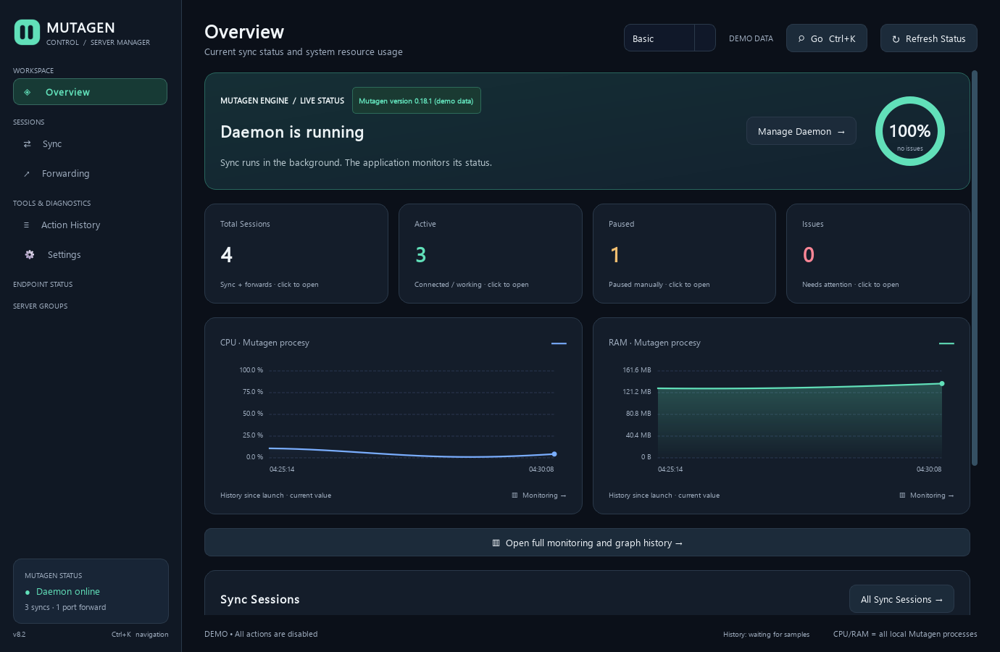 | Overview — English, dark, Basic, 100% |
| 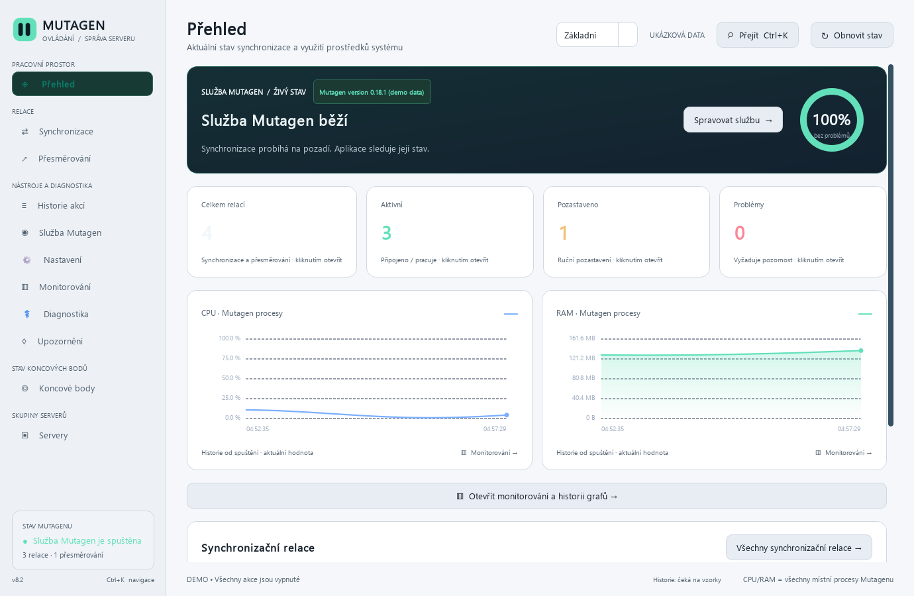 | Overview — Czech, light, Basic, 100% |
| 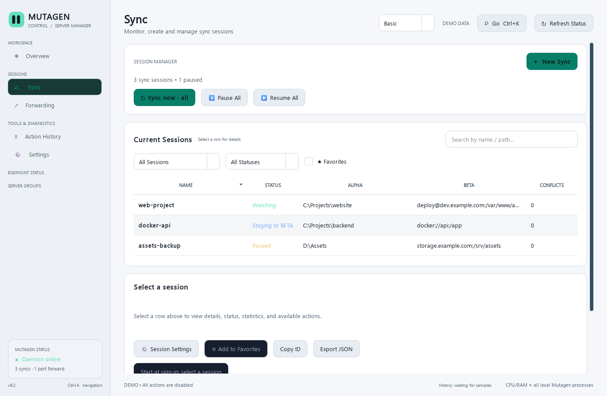 | Sync — English, light, Basic, 150% |
| 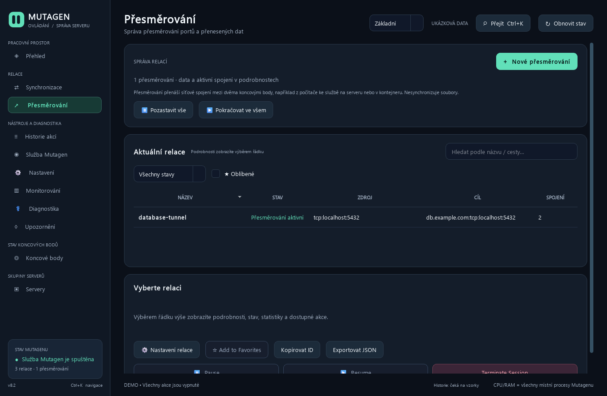 | Forward — Czech, dark, Advanced, 100% |
| 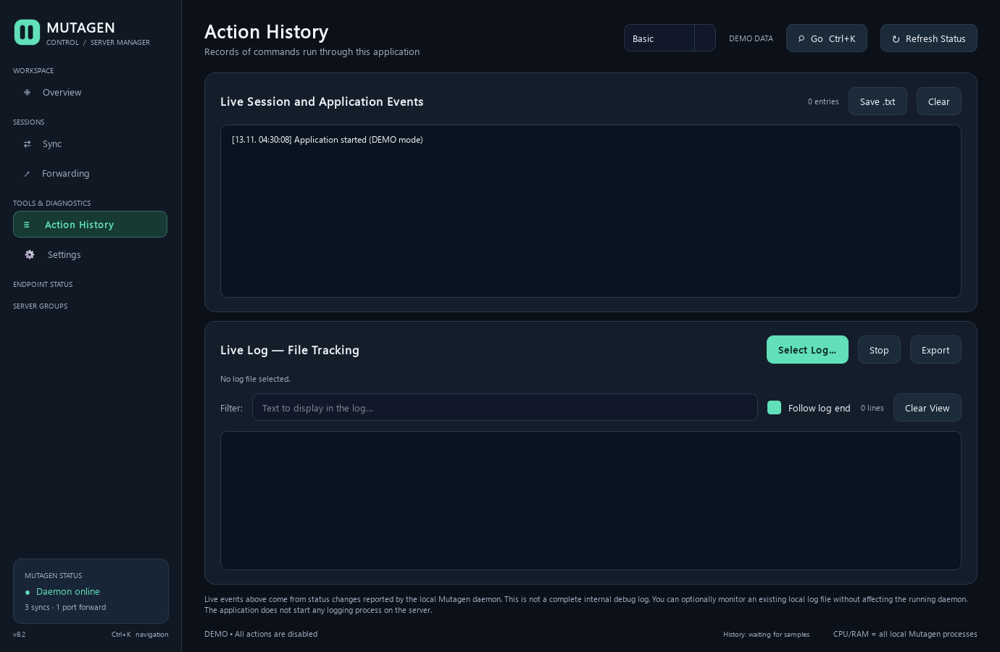 | History — English, dark, Basic, 100% |
| 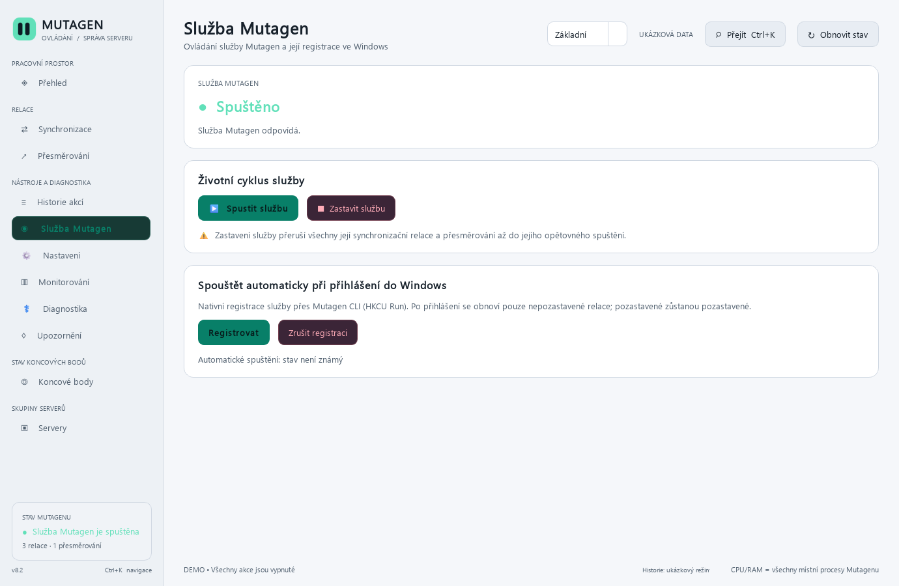 | Daemon — Czech, light, Advanced, 150% |
| 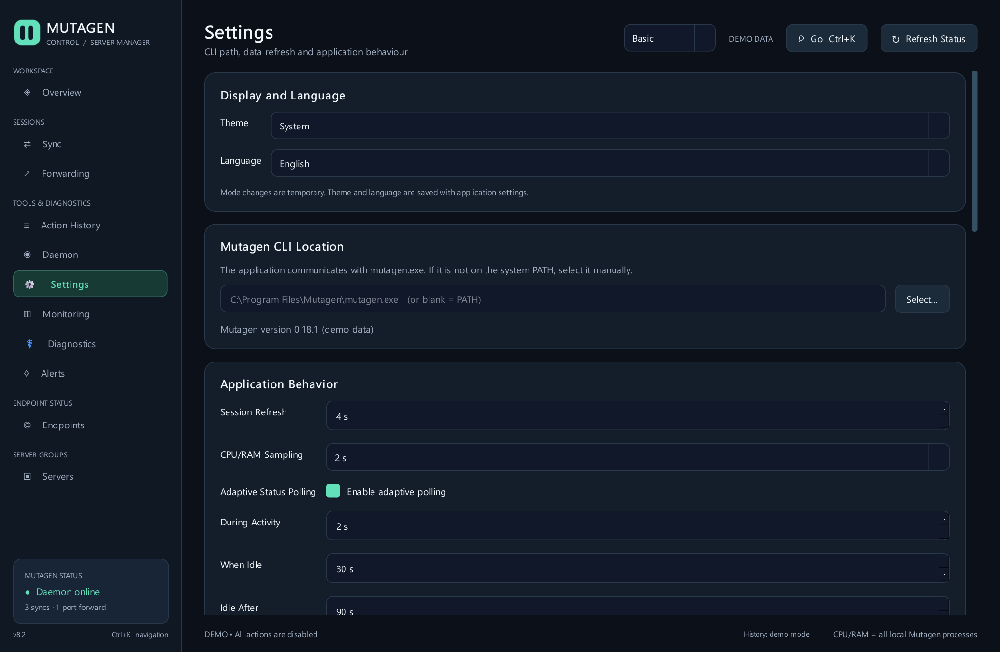 | Settings — English, dark, Advanced, 150% |
| 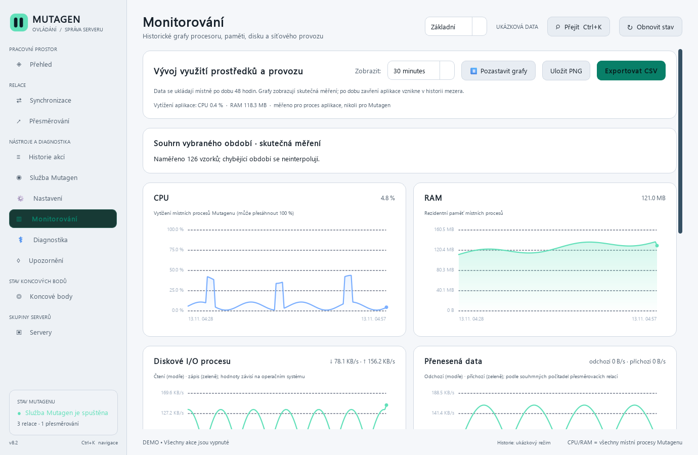 | Monitoring — Czech, light, Advanced, 150% |
| 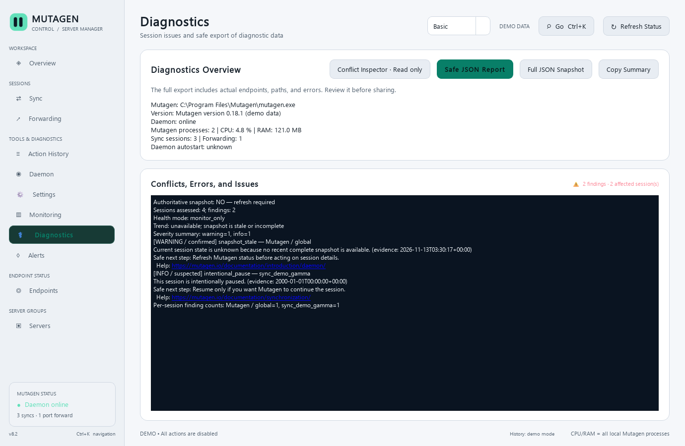 | Diagnostics — English, light, Advanced, 100% |
| 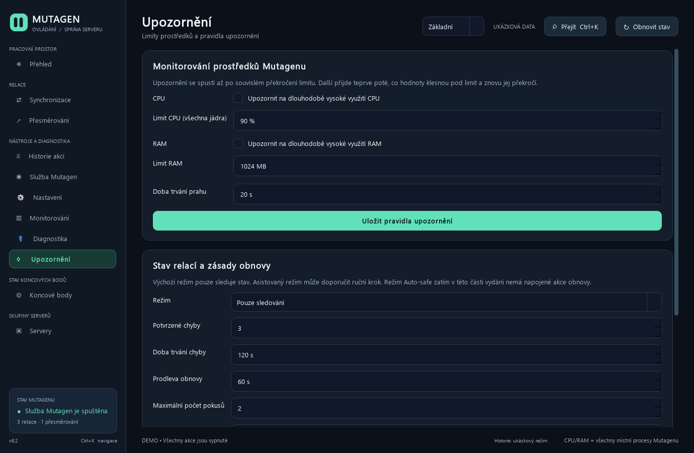 | Alerts — Czech, dark, Advanced, 100% |
| 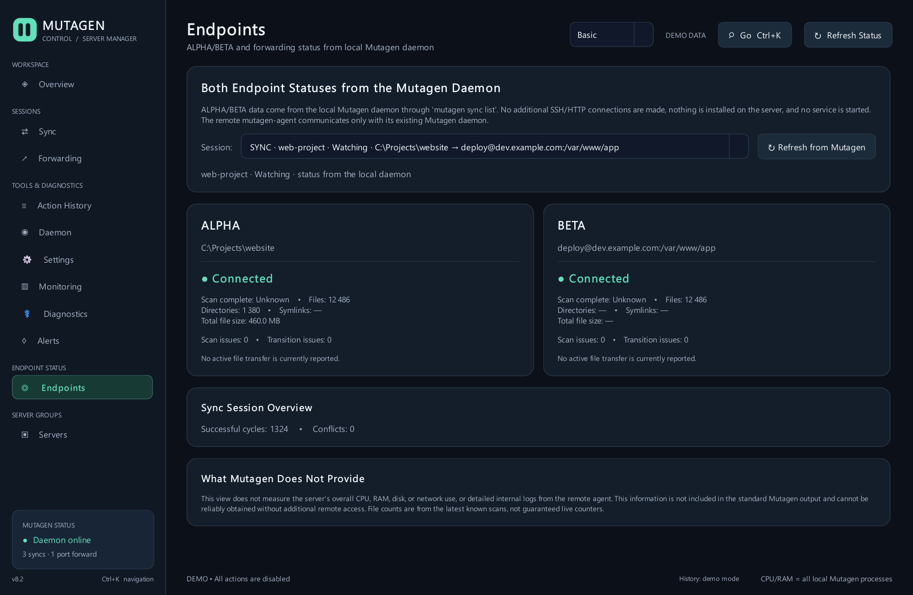 | Endpoints — English, dark, Advanced, 150% |
| 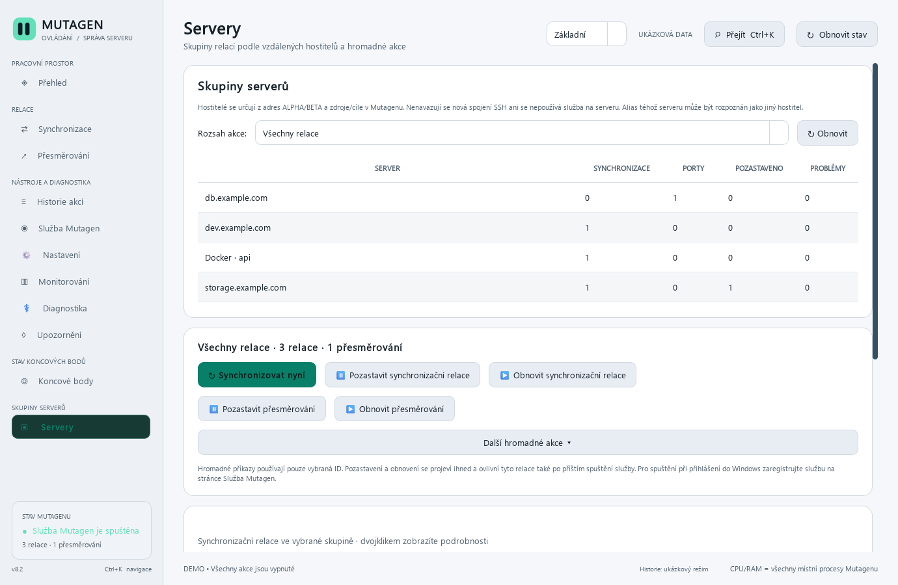 | Servers — Czech, light, Advanced, 150% |

The 12-case matrix also captures the remaining visible pages at varied theme, locale, mode, and scale combinations. Only the overview has had a focused manual visual review so far; the other captures still need page-by-page accessibility and overflow review.
